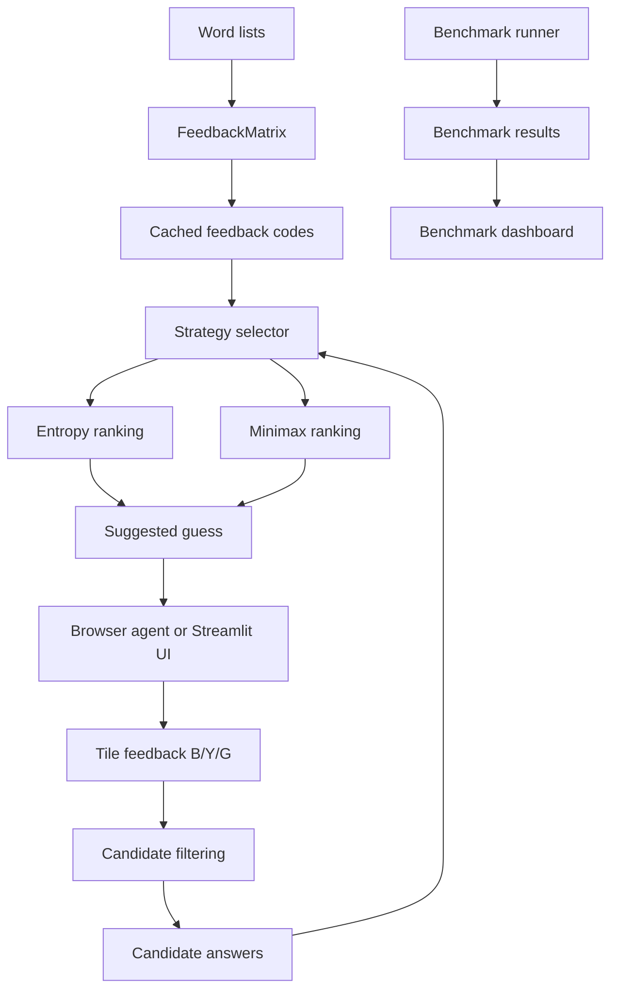

# Wordle AI

A Python Wordle solver comparing minimax and entropy strategies, with a feedback matrix, benchmark tooling, a Streamlit arena, and a Playwright agent that connects to an existing Brave session.

## Features
- Minimax ranking by worst-case remaining answers, with tie-breaks.
- Entropy ranking by expected information gain.
- Cached feedback matrix and duplicate-letter-aware feedback scoring.
- Browser agent reads Wordle tile states and filters possible answers.
- Benchmarking across a fixed answer list.
- Streamlit arena and benchmark dashboard.

## Reported benchmark snapshot

These values were reported for a 2,315-answer run. Re-run benchmarks on the current checkout before publishing results.

| Metric | Entropy | Minimax |
|---|---:|---:|
| Answers evaluated | 2,315 | 2,315 |
| Solved | 2,315/2,315 | 2,315/2,315 |
| Average guesses | 3.5279 | 3.5227 |
| Median guesses | 4 | 4 |
| Worst-case guesses | 6 | 5 |
| Runtime/game | 0.2708 s | 0.2153 s |
| Total runtime | 626.8 s | 498.5 s |

| Guesses | Entropy | Minimax |
|---|---:|---:|
| 1 | 0 | 1 |
| 2 | 31 | 67 |
| 3 | 1,100 | 1,040 |
| 4 | 1,116 | 1,135 |
| 5 | 67 | 72 |
| 6 | 1 | 0 |

Results depend on the word lists, code version, tie-breaks, and machine.

## Setup

```bash
python3 -m venv .venv
source .venv/bin/activate
pip install -r requirements.txt
export PYTHONPATH=src
python3 -m pytest -q
```

Run the existing arena:

```bash
PYTHONPATH=src python3 -m streamlit run app.py
```

Run your benchmark CLI using the flags supported by your checkout:

```bash
PYTHONPATH=src python3 -m wordle_ai.benchmark --strategy both
```

Use `python3 -m wordle_ai.benchmark --help` if your CLI differs.

## Browser agent

Open Brave with remote debugging enabled, open a fresh Wordle board, then run:

```bash
PYTHONPATH=src python3 browser_agent.py --strategy minimax
```

Use `--strategy entropy` to compare strategies. Test confirmation mode before enabling automatic submissions.

**Security:** CDP access can control tabs and inspect authenticated browser sessions. Keep the debugging port on localhost, never expose it publicly, and close the debugging-enabled browser when finished. The agent does not bypass ads, consent screens, or access restrictions.

## Architecture



## Before publishing
- Re-run both strategies on the same answer list and save the exact command.
- Record word-list provenance, Python/package versions, and machine details.
- Verify tests pass and inspect all files before committing.
- Add a screenshot or short GIF of the arena.
- Never commit `.venv`, browser profiles, cookies, secrets, or generated cache files.
- Add a license only after choosing one intentionally.
